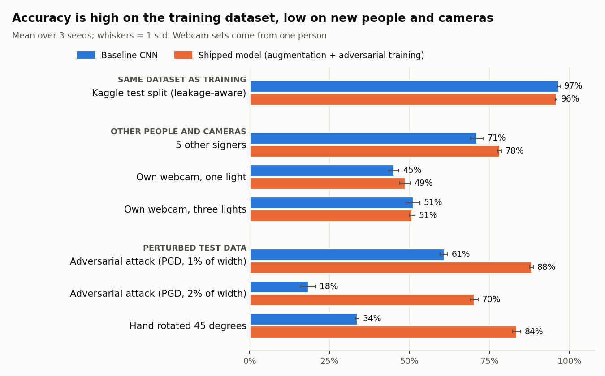

# Sign2Voice: Voice For All

Real-time American Sign Language (ASL) fingerspelling recognition. A webcam frame goes through MediaPipe Hands to get
21 hand landmarks, a small 1D-CNN classifies the letter, and the text is spoken aloud. It ships as a desktop GUI
(Tkinter) and a MERN web app for accounts and saved transcripts.

> **Read this first: what the numbers mean.** The original version of this project reported 99.15 % "on unseen data".
> That figure came from a *random* split of one dataset made of near-duplicate video frames, so it is leaky. This repo now
> measures the same model properly. On a leakage-aware split it gets about 96.7 %, on 5 other signers about 71 %, and on a
> real webcam only about 45-53 %. Those are the numbers to trust. Full details: [Results](#results) and
> [`docs/ROBUSTNESS.md`](docs/ROBUSTNESS.md).

## What is trained here and what is not
| Component | Status |
|---|---|
| Landmark classifier (Conv1D CNN, 589,852 parameters) | **Trained from scratch** in this repo (`ml/train.py`) |
| MediaPipe Hands (landmark detector) | Pretrained by Google, used unmodified |
| distilgpt2 (word suggestions) | Pretrained by Hugging Face, used unmodified, not evaluated |
| Text-to-speech | `pyttsx3` (system voices) |

Dataset: Kaggle [ASL Alphabet](https://www.kaggle.com/datasets/grassknoted/asl-alphabet) (grassknoted), 87,000 images,
3,000 per class. 28 classes are used (A-Z, `space`, `del`); `nothing` has too few detected hands and is dropped.
External test set: a second public ASL fingerspelling image set with 5 signers (`asl_dataset/`). Both datasets belong to their
authors and are not redistributed here.

## Model
Input: 63 numbers (21 landmarks × x, y, z, raw MediaPipe coordinates) → reshape (21, 3) → Conv1D(64) → Conv1D(128) →
Flatten → Dense(256) → Dropout(0.3) → Dense(28, softmax). Adam, sparse cross-entropy, batch 128, 20 epochs.

The shipped model (`ml/models/landmark_cnn.keras`) is the **augmentation + PGD adversarial training** variant, seed 42,
fully reproducible with the commands below. It trades about 0.8 points of clean accuracy for much better robustness
to rotation and to adversarial perturbations. The original 2025 model is kept for reference in `ml/models/original/`.

## Results
All numbers: mean ± std over 3 seeds unless stated. Generated by code, not typed by hand:
[`ml/results/eval_table.md`](ml/results/eval_table.md) and [`ml/results/robustness/summary.md`](ml/results/robustness/summary.md).



| Evaluation | Baseline (raw) | Shipped (aug + PGD-AT) |
|---|---|---|
| Kaggle, **random** split (leaky, original protocol) | 98.9 ± 0.1 | not run |
| Kaggle, **block** split (leakage-aware) | 96.7 ± 0.5 | 95.9 ± 0.3 |
| 5 other signers (n=1,286) | 71.1 ± 2.1 | 78.1 ± 0.7 |
| Own webcam, one light (n=2,838, one person) | 45.1 ± 1.5 | 48.6 ± 1.6 |
| Own webcam, three lights (n=3,481, one person) | 51.1 ± 2.2 | 50.8 ± 0.9 |
| PGD L∞ attack, ε = 0.01 (1 % of image width) | 60.8 ± 1.2 | 88.2 ± 0.5 |
| PGD L∞ attack, ε = 0.02 | 18.3 ± 2.4 | 70.2 ± 1.2 |
| Rotated 45° in the image plane | 33.7 ± 0.5 | 83.5 ± 1.3 |

Take-aways:
* The dominant problem is **distribution shift** (other people, other cameras), not attacks. Adversarial training and
  augmentation help a little on other signers and not measurably on the webcam.
* Adversarial training and rotation augmentation fix *different* weaknesses; combining them is complementary.
* Normalising landmarks (wrist-centred, scale-normalised) gave no reliable gain, so raw landmarks are used.

### Limitations (please read)
* Webcam data comes from one person in two lighting conditions. It tests lighting and setup, not new signers.
* The block split assumes Kaggle image numbers follow video order. This was checked on the landmarks (neighbouring ids are ~10x closer than random pairs), and a 100-frame gap instead of 25 changed accuracy by only 0.4 points (one seed).
* Attack results are PGD-20 on a 5,000-sample subset, white-box, in landmark space only. MediaPipe is not attacked, no
  adaptive attacks, no certification. Treat them as upper bounds on true robustness.
* `J` and `Z` are motion letters and are classified from single frames.
* 4 letters get zero recall on the external set (D, N, T, Z) and about 10 on the webcam; the cause is not established.
* Word suggestions (distilgpt2) were not evaluated.

## Repository layout
```
ml/            training, evaluation, robustness study, results
  extract_landmarks.py  train.py  eval.py  features.py  make_table.py  record_webcam.py
  robustness/           perturb.py attacks.py train_robust.py run_eval.py report.py
  models/               shipped model + class list;  original/ = the 2025 model
  results/              committed tables and plots
  legacy/               old image-CNN baseline (unused)
desktop/       Tkinter GUI, TTS, word suggestions
web/Server     Express + MongoDB API (auth, saved transcripts)
web/Client     React (Vite) front end
docs/          ROBUSTNESS.md
```

## Run it
The install steps below were verified from a fresh clone on Windows with Python 3.11 and Node (2026-11-25): both pip installs, `npm ci`
in `web/Server` and `web/Client`, the client build, a 1-epoch training smoke test, and loading the shipped model.

### 1. ML pipeline (Python 3.11)
```bash
python -m venv .venv && source .venv/bin/activate        # Windows: .venv\Scripts\activate
pip install -r ml/requirements.txt

# data: download Kaggle ASL Alphabet and unzip so that raw/asl_alphabet_train/<LETTER>/*.jpg exists
python -m ml.extract_landmarks --dataset raw/asl_alphabet_train --output ml/data/landmarks_v2.npz

# baseline, block split, raw landmarks (3 seeds: 42, 1, 2)
python -m ml.train --data ml/data/landmarks_v2.npz --mode raw --split block --name raw_block --seed 42
# robust variants: aug | adv | augadv
python -m ml.robustness.train_robust --variant augadv --seed 42

python -m ml.make_table                  # -> ml/results/eval_table.md
python -m ml.robustness.run_eval         # attacks + perturbations + held-out sets (slow)
python -m ml.robustness.report           # -> ml/results/robustness/
python -m ml.robustness.figure           # -> docs/results_at_a_glance.png
```
Seeds are fixed, but exact numbers can differ slightly across TensorFlow/CPU builds. To record your own test data:
`python -m ml.record_webcam --person me --tag mylight`.
`ml/data/landmarks_train.npz` (the original extraction, 73,500 rows) is committed for reference; it used MediaPipe's tracking
mode and is not what the reported results use.

### 2. Web app (needs Node 18+ and MongoDB)
```bash
cd web/Server
cp .env.example .env     # fill in MONGO_URI, JWT_SECRET (e.g. `openssl rand -hex 32`), ADMIN_EMAIL, ADMIN_PASSWORD
npm install
node createAdmin.js      # optional: creates the admin account from the env values
node main.js             # API on http://localhost:5000

cd ../Client && npm install && npm run dev
```
The server refuses to start without `JWT_SECRET`. Never commit `.env`. For the "Open Sign2Voice" button, set `PYTHON_BIN` to the venv python that has `desktop/requirements.txt` installed.

### 3. Desktop GUI
```bash
pip install -r desktop/requirements.txt
python desktop/gui_main.py     # log in with an account created in the web app (server must be running)
```
It loads `ml/models/landmark_cnn.keras`. Sign a letter and hold it steady; the GUI uses a confidence threshold and a majority
vote over recent frames. Buttons: Clear, Speak, Save (stores the sentence in your account; a status line shows the result),
View History, Exit. The page scrolls (scrollbar or mouse wheel), so all controls stay reachable at any window size.

Two ways to start it:
* **From the web dashboard ("Open Sign2Voice")**: you are already logged in, so the GUI reuses that session and skips its own login.
  The first launch can take 1-2 minutes (TensorFlow and torch load, and distilgpt2 weights of about 350 MB are downloaded once).
* **From a terminal** (`python desktop/gui_main.py`): the GUI shows its own login screen.

## Security notes
Earlier versions of this repo hard-coded an admin password and fell back to the JWT secret `"secret"`. Both are fixed
(secrets come from environment variables only). Any credentials from the old history should be considered compromised and rotated.

Current state, checked by reading the code:
* Passwords are hashed with bcrypt; sessions are JWTs that expire after 1 day; CORS only allows the web client origin.
* `/api/open-webcam` (which starts the desktop GUI) requires a valid login, and only one GUI instance can run at a time.
  The session token is handed to the GUI through an environment variable (not a command-line argument) and kept in memory only.
* Login and register endpoints are rate limited (20 attempts / 15 min / IP), accept only plain strings (no NoSQL operator
  injection), return generic error messages, and request bodies are capped at 100 kB. `npm audit` reports 0 known
  vulnerabilities in both Node projects (checked 2026-11-25; re-run it before relying on this).
* The "Open Sign2Voice" button starts the GUI **on the machine running the server**, so it only makes sense when the server
  runs locally. The web client also has `http://localhost:5000` hard-coded, so deploying it needs a configurable API URL.
* Known limitations: traffic is plain HTTP (fine on localhost, use HTTPS if deployed); the web client stores its token in
  `localStorage` (exposed if an XSS bug is introduced); there is no 2FA; the old admin password is still visible in git history (tag `v0-original`), so never reuse it.

## License
Code is released under the [MIT License](LICENSE). The datasets (Kaggle ASL Alphabet, `asl_dataset`), MediaPipe and
distilgpt2 keep their own licenses and are not covered by it.

## Possible future work
Collecting data from more signers, evaluating word suggestions, certified robustness, attacks through the camera/MediaPipe
stage, handling motion letters (J, Z) with video, mobile app.
